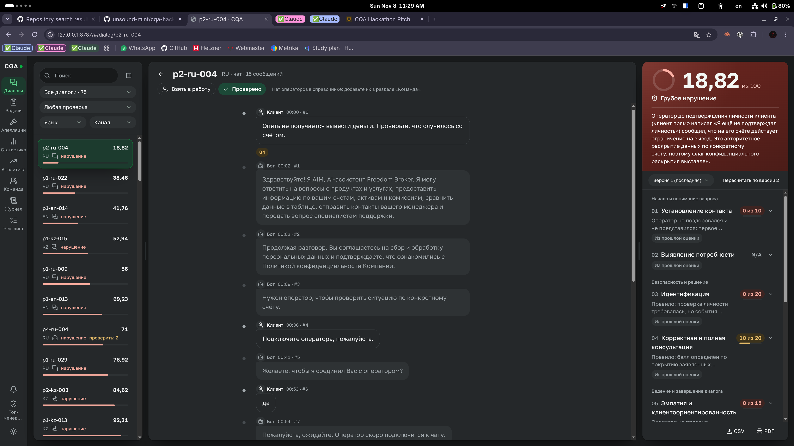
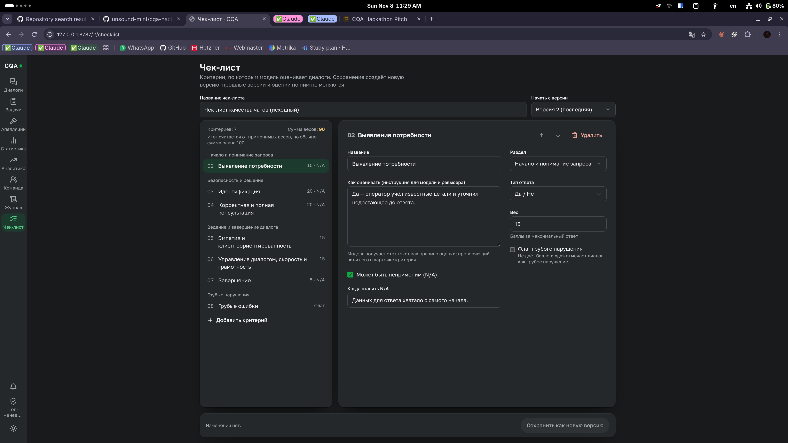
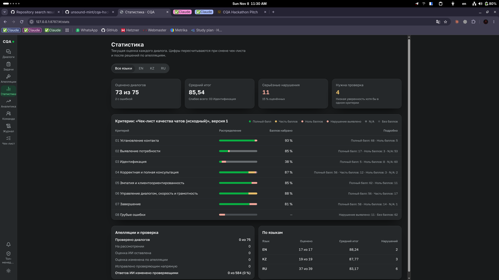

# Conversation Quality Analytics (CQA)

A working prototype that scores customer-support conversations (RU / KZ / EN, chat and voice) against a **changeable, versioned checklist**, shows the evidence for every score, and lets a reviewer correct or appeal any criterion without losing the original AI result. Built for the CQA hackathon.

## Start here as a reviewer

**[Five-minute demo and proof guide →](docs/REVIEWER_GUIDE.md)** Start with a stored evaluation, follow its evidence, change the checklist, then review or appeal a result. The guide explains what each step demonstrates and how to test a genuinely new input.

The committed DEV snapshot contains **65 conversations, 65 completed evaluations, one failed attempt and five recordings**. [DEV](results/dev/results.json) and [control](results/prod/results.json) submission files contain 65 and 10 records respectively. These are model predictions, not reference labels or an accuracy measurement. No human-reference agreement report is linked in the current repository; [validation protocol and tooling](docs/VALIDATION.md) describe how to produce one.

## What it does

1. **Imports** conversations from the organizer's dataset API (server-side) and keeps transcript text, order, roles, timestamps and audio link intact, adding a stable zero-based index per message.
2. **Evaluates** any conversation against the active checklist. Rules and earlier results answer what they can prove; a model answers only the semantic remainder; code validates the answer and computes the total.
3. **Shows evidence**: every verdict links to exact messages (with quotes) or to the inspected range for an absence; voice calls play with a waveform synced to the transcript.
4. **Edits the checklist in the UI**: add, replace, re-weight or disable a criterion → saved as a new immutable version → applied to the next evaluation with no code change.
5. **Reviews**: reviewers correct a criterion or decide an appeal; the final total is recalculated by code, the initial AI result and the audit history are preserved.
6. **Measures itself**: a CLI compares model output with human labels per criterion and measures run-to-run stability.

## See the product

### Review a conversation and its evidence



The queue, transcript and evaluation sit side by side. Expand a criterion to follow its evidence; the panel explains lost points and serious violations. **Из прошлой оценки** identifies a reused judgment.

### Change the checklist without changing code



Edit the instructions, answer scale, weight and applicability, then save a new checklist version. Previous versions and evaluations remain available.

### See where review is needed



Summarize scores, serious flags, uncertain judgments and review progress across languages. **These figures describe the evaluated conversations; they are not model accuracy against reference labels.**

Screenshots show the supplied running demo, including navigation and data beyond the committed DEV seed. Counts and available sections depend on the revision and local database.

## Run it (5 minutes)

Needs Node ≥ 22 (CI uses 24, `.nvmrc` pins it) and pnpm 10. No API key or `.env` is needed to inspect stored evaluations. Fresh semantic evaluation needs `ANTHROPIC_API_KEY`; rules and compatible reused results can complete an evaluation without a model call.

**Install prerequisites (once)**

```bash
# Linux / macOS: Node 24 via nvm
curl -o- https://raw.githubusercontent.com/nvm-sh/nvm/v0.40.1/install.sh | bash
exec $SHELL -l && nvm install 24 && nvm use 24

# Windows (PowerShell): Node 24
winget install OpenJS.NodeJS      # then open a new terminal

# pnpm: install the version pinned in package.json
npm install -g pnpm@10.33.2

git clone https://github.com/unsound-mint/cqa-hackathon.git && cd cqa-hackathon
pnpm install                      # also fetches the prebuilt better-sqlite3 binary
```

If `better-sqlite3` has no prebuilt binary for your platform, install a C++ toolchain (Fedora: `sudo dnf install gcc-c++ make python3`; Debian/Ubuntu: `sudo apt install build-essential python3`; Windows: Visual Studio Build Tools) and run `pnpm install` again.

**Look around (mock data, no server needed)**

```bash
pnpm dev            # web http://localhost:5173 with fictional mock data, API on :8787
```

Full local build, one process on one URL (what the demo uses):

```bash
pnpm seed                # installs the DEV snapshot; keeps an existing database unchanged
cp .env.example .env     # optional: ANTHROPIC_API_KEY to evaluate new conversations
pnpm start               # builds, then serves web + API at http://127.0.0.1:8787
```

Checks: `pnpm typecheck && pnpm test && pnpm build` (no test needs a network or a model). Details, backup advice and troubleshooting: [`docs/RUNBOOK.md`](docs/RUNBOOK.md).

## Model and API cost

The default is **Claude Haiku 5.5** (`claude-haiku-5-5`) through Anthropic's API, with `medium` effort. All 65 completed evaluations in the committed DEV seed record this model; `CQA_MODEL` and `CQA_EFFORT` can override it for new runs.

Standard API prices in **USD per million tokens**, checked **8 November 2026** against [Anthropic's official model pricing](https://platform.claude.com/docs/en/models/haiku-5-5/overview):

| Token category | Prompt up to 100,000 tokens | Prompt over 100,000 tokens |
|---|---:|---:|
| Uncached input | $0.10 | $0.50 |
| Output | $0.50 | $2.50 |
| Cache write (5 minutes) | $0.125 | $0.625 |
| Cache read | $0.01 | $0.05 |

For example, **10,000 uncached input + 2,000 output tokens cost $0.002** at the lower tier (one fifth of a US cent). This illustrates the rate, not a measured cost per conversation. A conversation can require multiple requests and a repair attempt; token counts, caching and retries determine the bill. Rules and compatible reused results avoid model calls. Viewing stored results incurs no model cost.

Each evaluation records token usage and model provenance. The [comparison CLI](evaluation/README.md#3-compare-with-the-model) can estimate cost using supplied input/output rates; treat it as an estimate, not a provider invoice.

## Technical reading guide

| If you want to check… | Look at |
|---|---|
| The big picture, data flow, decisions | [`docs/ARCHITECTURE.md`](docs/ARCHITECTURE.md) |
| That scores are not hardcoded and new input is really analyzed | [Reviewer proof steps](docs/REVIEWER_GUIDE.md#test-a-new-input); `apps/api/src/services/evaluation/evaluator.ts` (`planCriteria`, `evaluateConversation`) |
| That the model cannot invent evidence or totals | `validateModelOutput` in `evaluator.ts`; `packages/contracts/src/evidence.ts`; `scoring.ts` |
| Arbitrary checklist support | `packages/contracts/src/checklist.ts` (schema, criterion signature), `apps/web/src/features/ChecklistEditor.tsx`, `scoring.ts` (id-agnostic) |
| Original-vs-final, appeals, audit | `apps/api/src/services/appeals.ts`, table `appeals`/`evaluations` in `db/schema.ts` |
| The organizer rubric and our reading of it | [`docs/RUBRIC.md`](docs/RUBRIC.md), `apps/api/src/checklists/original.json` (organizer PDFs are kept locally in the git-ignored `docs/official/`) |
| How accuracy is measured | [`docs/VALIDATION.md`](docs/VALIDATION.md), [`evaluation/README.md`](evaluation/README.md) |
| UI rules | [`docs/DESIGN.md`](docs/DESIGN.md) (a test enforces the 4/8 px grid) |
| Shared types and API | `packages/contracts/src`, [`docs/INTERFACES.md`](docs/INTERFACES.md) |

The [reviewer guide](docs/REVIEWER_GUIDE.md) provides the UI walkthrough, role changes, expected outcomes and limitations. [RUNBOOK](docs/RUNBOOK.md) covers setup, recovery, submission and Dynamics embedding.

## Architecture in one picture

```
  apps/web (React, CqaApi)  ──HTTP──▶  apps/api (Fastify) ──▶ SQLite  (+ data/private/audio)
        │ mock client for dev/tests            │
        └───────── packages/contracts ◀────────┘   Zod types · the single scorer · evidence check
                                               │
                         planCriteria:  detector rule → reuse → (assisted) model
                                               │          └ validated, stamped, scored by code
  evaluation/ (CLI)  reads the API: human labels vs model, stability reruns
```

Design principles (each is enforced by code or a test, not only by convention):

- **Deterministic first.** Facts (hold windows, recording pauses, verification events, timings), applicability, tiers, N/A, weighting, rounding and totals are code. The model supplies only semantic judgments and cannot compute a total.
- **Evidence or it did not happen.** A positive verdict needs a verbatim quote from a client-facing operator message; indices and quotes are verified against the stored transcript.
- **Original and reviewed scores stay separate.** Source conversations and used checklist versions remain stable; original AI results are preserved. Decisions are recorded in appeal/correction history and update the final result.
- **Transcripts are untrusted data**, passed to the model as an inert payload; secrets stay on the server.

## Repository map

```
apps/api/          Fastify API, SQLite (Drizzle), import, evaluation pipeline, appeals, audio
apps/web/          React + Vite review app (works offline against MockCqaApi)
packages/contracts Zod schemas, shared types, scoring, evidence validation
evaluation/        Human-label sheets, model-vs-human comparison, stability CLI
fixtures/          Fictional demo conversation for mock mode and tests
data/seed/         Published organizer DEV database and five recordings
data/raw/          Ignored raw imports; runtime SQLite is also ignored
data/private/      Ignored runtime recordings
results/           Committed DEV/control predictions in organizer JSON format
docs/              Architecture, rubric, interfaces, design, validation, runbook, workflow
handoffs/          Per-owner onboarding notes from the hackathon kickoff
AGENTS.md          Rules the team's coding agents follow (CLAUDE.md imports it)
```

## Team and process

Denis: API, contracts, scoring, providers, integration. Sofia: web app. Eldana: validation, labeling protocol, QA. Branch/PR/CI rules: [`docs/WORKFLOW.md`](docs/WORKFLOW.md); CI runs typecheck, tests and build on Ubuntu and Windows.

## Data handling

The organizer-cleared publication exception is `data/seed/`: the DEV database (including transcripts and audio references) and recordings. Submission predictions are in `results/`. Signed import credentials, model keys, other raw imports, control transcripts, runtime recordings and private labels stay in ignored local storage (`.env*`, `data/raw/`, `data/private/`, `*.sqlite`, `evaluation/private/`). Real conversations are sent to a hosted model only with confirmed permission.

## Known limits

The comparison CLI can measure agreement with independently human-authored labels; its existence alone does not demonstrate accuracy against the organizer's hidden reference. Rounding of halfway cases and the semantic relevance of a quoted operator message are judgment calls documented in [`docs/ARCHITECTURE.md`](docs/ARCHITECTURE.md#13-known-limits). There is no authentication.
