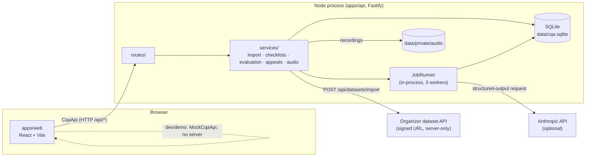
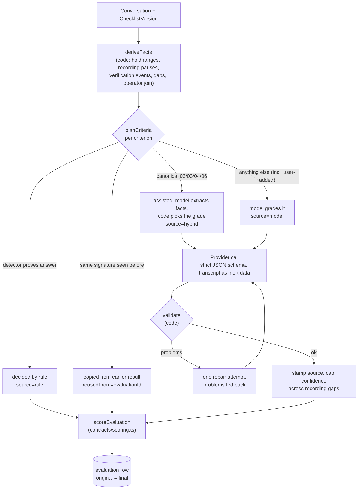

# Architecture

How the system is built and why. For a quick tour start with the [README](../README.md); this page is the full picture. Exact data shapes live in code (`packages/contracts/src`), not here.

## 1. One-paragraph summary

A single Node process serves a React review app and a Fastify JSON API over one SQLite file. Conversations are imported once and never change. An evaluation applies an immutable, versioned **checklist** to a conversation. **Code decides everything it can** (rules, reuse of earlier results, validation, scoring); the language model is asked only narrow semantic questions, and its answers are rejected unless they cite real operator text. The AI result is stored once and never edited; reviewer corrections and appeals produce a separate *final* result and an audit trail.

## 2. System context



- **Production-style run:** `pnpm start` builds everything; the API serves `apps/web/dist` and `/api` on one port (8787). No Docker, no queue service, no external database.
- **Browser never calls the model or the organizer API.** The signed dataset URL and the model key are server-only environment variables.
- **No authentication** by design (hackathon demo). A role picker (operator / reviewer / lead, `contracts/roles.ts`) sends `x-cqa-role` and `x-cqa-actor` (URI-encoded name) with every request; the API enforces what each role may do and see (`routes/actor.ts`). It separates responsibilities, it is not security: any client can send any role. A request without a role is unrestricted (exporter, stability runner, scripts), so they keep working.

## 3. Repository layout and module boundaries

| Path | Responsibility | Depends on |
|---|---|---|
| `packages/contracts` | Zod schemas and TypeScript types for every shared shape, **the one scoring function** (`scoring.ts`), the evidence grounding check (`evidence.ts`), criterion signature (`checklist.ts`). Consumed as TS source, no build step. | zod |
| `apps/api` | Fastify routes, SQLite/Drizzle storage, import, evaluation pipeline, jobs, appeals, audio. | contracts |
| `apps/web` | Review workspace, checklist editor, appeals queue, print/export. Talks only to the `CqaApi` interface. | contracts |
| `evaluation` | Human-label sheets, comparison and run-to-run stability reports. A CLI that reads the running API. **Never imported by production code.** | contracts |
| `fixtures/demo.json` | Fictional conversation for mock mode and tests; published DEV data is separate in `data/seed/`. | – |
| `data/seed/` | Published organizer DEV snapshot: database and five recordings. `pnpm seed` copies it into runtime storage. | – |
| Runtime data (git-ignored) | `data/cqa.sqlite`, `data/raw/`, `data/private/`: working database, raw imports and recordings. | – |
| `results/` | DEV/control model predictions in organizer JSON format; not reference labels. | – |
| `docs/` | This documentation. `docs/official/` (organizer PDFs, local only, git-ignored) is not in the repository. | – |

Rule of thumb: contracts ← api, web, evaluation. api and web never import each other.

### Backend layout (`apps/api/src`)

```
app.ts                    app factory: db, provider from env, JobRunner, routes, static web
routes/                   thin HTTP layer: validate with contract schemas, call services, map errors
db/                       Drizzle schema + additive idempotent migrations
checklists/original.json  organizer's 8 criteria (control data, version 1)
services/
  import/                 fetch (retry/backoff) → parse → idempotent insert
  checklists.ts           immutable versions, seeding
  conversations.ts        read model
  evaluations.ts          row ↔ DTO mapping
  appeals.ts              appeals, reviewer corrections, final-result recalculation
  audio.ts                resolve organizer player page → media, local store, range serving
  evaluation/
    facts.ts              deterministic transcript facts (hold, recording pauses, verification events, gaps)
    detectors/            rule detectors (greeting-intro, closing) + assisted detector (verification)
    semantic/             assisted helpers for criteria 02, 04, 06 (model extracts facts, code grades)
    rubric.ts             recognizes the original criteria by signature
    calibration.ts        fictional few-shot examples, selected by signature
    prompts.ts            system prompt, PROMPT_VERSION
    output-schema.ts      per-request strict JSON schema for the model
    evaluator.ts          plan → model → validate → stamp → score
    reuse.ts              result reuse + cache compatibility, EVALUATOR_VERSION
    jobs.ts               resumable batch runner
    provider.ts / anthropic.ts   provider-neutral interface + the one adapter
```

### Frontend layout (`apps/web/src`)

```
api/        CqaApi (interface), HttpCqaApi, MockCqaApi + demoExtras; createApi() is the only switch
features/   DialogsPage (workspace) · QueueRail · Transcript · CallTimeline · EvaluationPanel
            ChecklistEditor · Appeals · AppealsPage · PrintReport · Sidebar
lib/        player (audio ↔ transcript sync), waveform, present (labels), queue, export, errors, theme
components/ui/   small primitives
```

`createApi()` picks the implementation: `VITE_API_MODE=mock|http`, default mock in `pnpm dev`, HTTP in the production build. Components never call `fetch` or import backend code, so the whole UI can be exercised with fictional data and no server.

## 4. Data model (SQLite)

| Table | Mutability | Notes |
|---|---|---|
| `conversations` | immutable | Transcript JSON exactly as received plus a zero-based `index` per message; audio URL kept untouched. Re-import of identical data is a no-op (`imported_at` keeps the first time the dialog was stored); same id with different content → HTTP 409 (new id required), so evidence can never drift. |
| `checklist_versions` | insert-only | Every save is `max(version)+1`. Version 1 is `original.json`. Rewritten only if it is outdated *and* unused. |
| `evaluations` | `original_*` write-once; `final_*` and `serious_violation` rewritten by appeals | Also stores `provenance` (provider, model, prompt version, effort, tokens, latency), `cache_context`, `decision_facts` (validated model-extracted facts), `error`. |
| `appeals` | append-only | `kind` = `appeal` or `correction` (reviewer override without an appeal). A decided row is never rewritten. `created_by` / `decided_by` hold the display names from the role picker. |
| `operator_assignments` | upsert | Dialog → operator, set by the lead (the organizer data carries no operator identity). Its own table so a re-import, which rewrites the conversation row, never touches it. |
| `reviews` | upsert | One human check per dialog: `in_review` / `reviewed`, who and when, bound to the `evaluation_id` that was looked at. A newer evaluation makes it stale (the dialog counts as new again). Not part of the immutable evaluation. |
| `jobs` | progress counters | Holds conversation ids, checklist id, `force`, produced evaluation ids → resumable after restart. |

Migrations are additive and idempotent (nullable columns added on open); there is no destructive migration. Back up `data/cqa.sqlite` before deployment.

## 5. The evaluation pipeline

Entry: `POST /api/evaluations { conversationIds, checklistVersionId, force? }` → `JobRunner.start` → one job, processed by up to 3 concurrent workers, polled via `GET /api/jobs/:id`.



### 5.1 Who decides what

For each criterion, in this order (`evaluator.ts: planCriteria`):

1. **Detector** (`Criterion.detector`). A detector may only *prove* an answer; when it cannot, it returns undecided — never "No". Examples: 01 greeting + introduction in the client's language in the first operator turn → Yes; 07 any one of an offer of help, a goodbye or a courteous acknowledgement in the last operator turn → Yes. Detectors apply only while the criterion still matches the canonical rubric signature; if someone edits the instructions, scale or N/A rule, the criterion silently falls back to the generic model path.
2. **Reuse** (`reuse.ts`). If the same conversation already has an original result for a criterion with the same **signature** (instructions, kind, values, N/A rule, flag, detector — *not* weight, title, section, hint), it is copied with `reusedFrom`. Re-weighting or switching a criterion off therefore needs no model call and no API key. Reviewer overrides are never carried over. Reuse also requires the same input hash, `EVALUATOR_VERSION`, `PROMPT_VERSION` and, when a provider is configured, the same provider/model/effort.
3. **Assisted helpers** (canonical 02, 03, 04, 06). The model returns *facts with quoted evidence* (e.g. which customer requests exist and how each was handled); code applies N/A precedence and the exact tier rules.
   - 03 identity verification: model answers "was verification required?" and "which operator message first disclosed protected data or acted on the account?"; code compares that index with explicit system verification events (RU/KZ/EN). Not required → N/A; verified before → Yes; otherwise No, with `low` confidence if a recording pause may hide the confirmation.
   - 02 / 04 / 06: see `docs/RUBRIC.md` ("Deterministic semantic decisions"). 04 and 06 run as a separate model request from 02/03 to stay under the provider's compiled-grammar limit; each slice has its own repair attempt and a partial success is never persisted.
4. **Model** for everything else, including every criterion a user adds in the editor. A model-returned result for an assisted criterion is rejected.

If rules and reuse settle everything, the provider is never called; `POST /api/evaluations` answers 503 only when a model is actually needed and none is configured.

### 5.2 What is validated before anything is stored (`validateModelOutput`, `validateAssisted`)

- value ∈ `allowedValues`; N/A only if the criterion allows it, with a reason; every criterion answered exactly once, no unknown ids.
- A positive action (yes, or a tier above the minimum, or a raised flag) needs a **non-empty verbatim quote** from a *client-facing operator* message — not bot, client, system, or operator speech during a hold/consultation. Bot/client/system text is context only.
- Absence/N/A claims need an inspected `checkedRange`; enum answers declare `decisionBasis`.
- All evidence indices exist and quotes occur in that message (`findEvidenceProblems`).
- The model's `source` and `reusedFrom` are ignored; code stamps them. Confidence `high` is capped to `medium` when the inspected range overlaps a recording pause.
- Failure → the problem list goes back to the model once. Second failure → the evaluation is stored as `failed` with the error; nothing partial is saved.

### 5.3 Scoring and totals

`packages/contracts/src/scoring.ts` is the **only** scorer; the API, the mock client, the comparison tool and appeals all call it. It is driven by `kind`, `allowedValues`, `weight`, `allowNA` — never by criterion id — so arbitrary valid checklists score correctly. Yes=1/No=0; scales normalize to `value / max tier`; N/A removes the weight from numerator and denominator; no applicable weight → total `null`; two-decimal rounding, halves away from zero (organizer has not specified; change only by human decision); invalid states throw `ScoringError` (fail closed). The serious-violation flag is separate from the score. The model never computes a total.

### 5.4 Changed checklists

`POST /api/checklists` validates the checklist (schema rules in `contracts/checklist.ts`, unknown detector names rejected) and stores it as a new version. A criterion without a detector is graded generically from its own `instructions`/values/N/A rule, so replacing a criterion in the UI affects the next evaluation with no code change. Old versions and their evaluations stay untouched, so versions can be compared.

## 6. Review, appeals and audit

- `finalResults`/`finalTotal` start as a copy of the originals. `originalResults`/`originalTotal` are never written again.
- **Roles.** Operator: sees only dialogs assigned to them (list, single reads, evaluations, appeals, audio are all scoped server-side; others answer 404), files appeals, follows them. Reviewer: sees everything, marks review state, corrects criteria, decides appeals, starts evaluations. Lead: all of that plus checklist versions, operator assignment and import. 403 for a missing permission.
- **Appeal** (`POST /api/evaluations/:id/appeals`): an operator files a comment against one of their own dialogs' criteria; one pending appeal per criterion. **Decision** (`POST /api/appeals/:id/decision`): `uphold` leaves the AI result, `override` supplies a value or N/A + reason.
- **Correction** (`POST /api/evaluations/:id/overrides`): a reviewer changes a criterion directly; stored as an already-decided appeal of kind `correction`, refused (409) while an appeal is pending on that criterion.
- On override the scorer recomputes `finalTotal` and `serious_violation` from the stored checklist version, inside a transaction. The overridden result carries the reviewer's reason and `source: 'reviewer'`; the AI's explanation remains in `originalResults`. Evidence and decision facts are kept.

- **Review state** (`POST /api/conversations/:id/review` `{status: new|in_review|reviewed}`): bound to the dialog's latest evaluation; `new` reopens. A correction or decision by a reviewer moves the dialog to `in_review` but never to `reviewed`: one criterion is not a full check. Only the explicit action finishes it.
- **Assignment** (`POST /api/conversations/operator` `{conversationIds, operator|null}`) and `GET /api/operators` (names, for the role picker).

## 7. Audio and evidence navigation

Voice calls keep the organizer's player-page URL untouched. `audio.ts` resolves the page to the actual media on demand, stores a copy under `data/private/audio/` (prefetched after import), and serves it with HTTP range support; before a copy exists the endpoint redirects to the resolved media. The web `player` syncs playback with the transcript, and `CallTimeline` draws a speaker-coloured waveform with recording pauses and evidence markers. Evidence chips jump to the exact zero-based message. The UI does not claim tone or diction from text; audio-only claims are not made.

## 8. HTTP API

All shapes are the Zod schemas in `packages/contracts/src/api.ts` and `domain.ts`.

| Route | Purpose |
|---|---|
| `GET /health` | liveness |
| `POST /api/datasets/import` `{groupId}` | server-side fetch of the organizer dataset (retry/backoff, `group_id` overridden), idempotent insert, recordings prefetched |
| `GET /api/conversations`, `/:id` | list (filters language/channel) / one; carries `importedAt`, `operatorId`, `review`; scoped for operators |
| `POST /api/conversations/:id/review`, `POST /api/conversations/operator`, `GET /api/operators` | review state, operator assignment, known operators |
| `GET /api/conversations/:id/audio` | recording with ranges |
| `GET /api/checklists`, `/:id`, `POST /api/checklists` | versions; save = new version |
| `GET /api/detectors` | detector names the editor may reference |
| `POST /api/evaluations` | start job (202 `{jobId}`); `force` bypasses reuse |
| `GET /api/jobs/:id` | progress + evaluation ids |
| `GET /api/evaluations`, `/:id` | list (`?conversationId=`) / one |
| `GET/POST /api/evaluations/:id/appeals` | list / file appeal |
| `POST /api/evaluations/:id/overrides` | reviewer correction |
| `GET /api/appeals?status=` | approver queue across dialogs |
| `POST /api/appeals/:id/decision` | uphold / override |

Errors map to 400 (invalid), 403 (role lacks the permission), 404, 409 (conflict), 502 (import upstream), 503 (model needed but absent); the web client turns them into `CqaApiError('invalid'|'not_found'|'conflict'|'forbidden')`, identical to the mock.

## 9. Versioning and provenance

Every evaluation stores: checklist version id, provider, model, effort, `PROMPT_VERSION` (prompt text + output schema + calibration), token usage and latency; every criterion result stores `source` (`rule` | `hybrid` | `model` | `reviewer`), `confidence`, and `reusedFrom`. Bump rules:

- `PROMPT_VERSION` (`prompts.ts`) — any prompt, schema or calibration wording change.
- `EVALUATOR_VERSION` (`reuse.ts`) — any change to rules, validators, attribution or reuse semantics.

Bumping either invalidates cached results; legacy rows without a cache context are kept but never reused. `provider: 'mock'` marks fictional output and the UI labels it.

## 10. Security and privacy

- Transcripts are untrusted data: sent to the model as a JSON payload field, never concatenated into instructions; model output is validated, never executed.
- Secrets (`DATASET_IMPORT_URL`, `ANTHROPIC_API_KEY`) are unprefixed server env vars; `VITE_*` is public and holds no secret. The importer never logs or returns the URL.
- `data/seed/` is the organizer-cleared publication exception: the DEV database and recordings are committed. Runtime SQLite, other raw imports, recordings and private labels remain ignored (`*.sqlite`, `data/raw/`, `data/private/`, `evaluation/private/`). `results/` contains submitted predictions, not control transcripts or reference labels.
- Real calls are not sent to a hosted model without confirmed permission. Only an Anthropic adapter exists; another provider means one new class implementing `LlmProvider`.
- No hardcoded outputs: nothing keys on conversation id, language or DEV content. Calibration examples are fictional and chosen by criterion signature.

## 11. Testing and CI

`pnpm typecheck && pnpm test && pnpm build` (CI: ubuntu + windows, Node 24, frozen lockfile). Tests are per package: contracts (schemas, scoring tables, fixture), api (evaluator with a fake provider, detectors, semantic facts, reuse/migration, appeals, import, audio, DB), web (mock client, HTTP client, a11y, 4/8px grid enforcement, player, export), evaluation (comparison, CSV, labels, stability). No test calls a real model or network.

## 12. Key decisions and trade-offs

| Decision | Why | Cost |
|---|---|---|
| Rules → reuse → model, in that order | Accuracy and reproducibility; cost and latency; rule-decided criteria never flip between runs | More code than a single prompt; each detector must be conservative (undecided, never "No") |
| Model extracts facts, code grades (02, 03, 04, 06) | Rubric tiers are exact; the model is poor at consistently applying them, good at reading | Helpers only apply to unchanged canonical criteria; edited ones use the generic path |
| Signature-based matching, not ids | Renaming/re-weighting keeps fast paths; edited semantics lose them, so a changed checklist is never graded by stale logic | Signature must stay in sync with what affects grading |
| Immutable conversations, checklist versions, original results | Evidence indices stay valid; appeals and comparisons are auditable | Changed input needs a new conversation id |
| SQLite in-process job runner | One laptop, one URL, resumable via DB state | Not horizontally scalable; fine for the target scale |
| Single `CqaApi` interface with mock | UI built and tested without the backend; same contract both ways | Mock must be kept in step (both implement `CqaApi`; `mock.test.ts` and `http.test.ts` exercise each) |
| Strict structured output + one repair | Parse failures become a validation problem list, not a crash | Two requests for large checklists (grammar-size limit) |

## 13. Known limits

- The tooling can report agreement with human labels (see [validation protocol](VALIDATION.md)); no human-reference report is linked in the current repository. Stored predictions and format validation do not measure accuracy against the organizer's hidden ground truth.
- Semantic relevance of an operator quote still depends on model judgment; the validators prove the quote is real and operator-authored, not that it is the right quote.
- Voice transcripts are speech-recognition output; absence claims inside recording pauses are capped at medium confidence and flagged for human review.
- Rounding of halfway cases is provisional (§5.3). No authentication: the role is a demo switch that any client can spoof.
- Cost reporting is per-evaluation token usage in provenance; price conversion is done by the evaluation tool (`--price-in/--price-out`).
