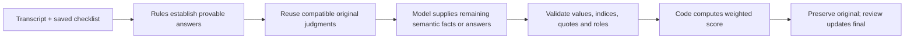

# Review CQA in five minutes

CQA turns a support conversation into an explainable checklist evaluation, then gives a human a way to inspect and challenge it. The same workflow handles RU/KZ/EN transcripts, voice-call evidence and a changed checklist. The main technical choice is to use code for scoring and verifiable rules, and the model for semantic judgments that code cannot settle.

## Choose what you want to verify

| Path | What you can establish | Needs |
|---|---|---|
| Stored DEV demo | Evidence navigation, audio, original/final results, checklist editing, review and exports | `pnpm install`, `pnpm seed`, `pnpm start`; no model key |
| Fictional mock preview | UI interactions against a mock adapter; results are simulated | `pnpm dev`; no model key |
| New semantic evaluation | The running system interprets a new transcript or new criterion | HTTP mode, model key, internet and permission for any real data sent |
| Reference comparison | Agreement with independently human-authored grades | Human labels plus evaluated conversations; [comparison CLI](../evaluation/README.md) |

A stored result demonstrates inspection; a mock result demonstrates interaction. To prove fresh inference, use the new-input or new-criterion steps below. Changing only a weight may legitimately reuse previous judgments.

## Five-minute demonstration

Start with [README setup](../README.md#run-it-5-minutes). Open `http://127.0.0.1:8787`. The UI is Russian; labels below match the interface. Use **Руководитель (Lead)** in the role picker for checklist editing and assignment. This is a demo role selector, not an authenticated login.

| Time | Action | What to point out |
|---|---|---|
| 0:00–1:00 | In **Диалоги**, open a completed conversation; expand a criterion and click its evidence. | The quote belongs to the original message index. Bot/system turns remain visible as context, but only operator behavior is scored. An absence claim has an inspected range instead of invented speech. |
| 1:00–1:30 | Open a voice conversation, play it and seek on the timeline. | Transcript/audio navigation, retained recording URL, and visible recording gaps. Text evidence does not establish vocal tone. |
| 1:30–3:00 | In **Чек-лист**, add the criterion below, save a new version, then return and **Пересчитать по версии …**. | New instructions produce a new result without code edits. Show the old evaluation in the version selector. This step needs a model key; saving alone does not prove new scoring. |
| 3:00–4:00 | Expand a scored criterion and submit a direct correction with a reason. | Final score is recalculated; the initial answer, explanation and original total remain available. Review state is separate from scoring. |
| 4:00–5:00 | Open **Статистика**, then return to an evaluation and export CSV or print PDF. | Criterion distributions, language breakdown, flags and review workload summarize current results. These are operational figures, not measured model accuracy. |

If model latency exceeds the slot, show progress and continue to review/export while it runs; return to the completed result before claiming the new criterion worked. Rehearse the live step on the presentation machine first.

### Add a criterion the application has not seen

In **Чек-лист → Добавить критерий**, use:

- **Название:** `Конкретный следующий шаг` (Concrete next step).
- **Тип ответа:** `Да / Нет`; **Вес:** `10`; N/A disabled; serious-violation flag disabled.
- **Как оценивать:** `Да, если оператор явно назвал конкретное действие, которое клиент или оператор должен выполнить дальше. Нет, если такого действия нет. Оценивай только сообщения оператора клиенту. Для «Да» приведи точную цитату; для «Нет» укажи проверенный диапазон сообщений.`

Save with **Сохранить как новую версию**. The generated criterion ID does not need to match any original rubric ID. Apply it to a conversation selected by the reviewer and inspect both its answer and evidence. Ideally use a newly imported conversation as well. Editing an existing criterion's instructions is another way to demonstrate changed semantics.

The weights need not sum to 100: applicable weights are normalized. Unchanged criteria may show **Из прошлой оценки** (reused from a prior evaluation); the new semantic criterion must be evaluated from its own instructions. Renaming a criterion or changing only its weight does not require a fresh semantic judgment.

### Demonstrate the appeal path separately

A direct correction and an operator appeal are different actions. As lead, assign a conversation to a demo operator. Switch to **Оператор** with that assigned name, open a criterion and file an appeal with a reason. Switch to **Проверяющий (Reviewer)** or lead, open **Апелляции**, and uphold or override it. Show the recorded comment, decision and original-versus-final result. Marking the whole dialog reviewed is an explicit separate action.

## Test a new input

The backend imports organizer-compatible groups through the server's configured `DATASET_IMPORT_URL`. It preserves message order, roles, timestamps, text and audio URL, adding stable zero-based indices. The default browser workflow reviews imported data; it is not a free-text transcript upload form.

With the HTTP server running and the signed source configured privately, import the reviewer-provided group:

```bash
curl -X POST http://127.0.0.1:8787/api/datasets/import \
  -H 'content-type: application/json' \
  -d '{"groupId":"<reviewer-provided-group>"}'
```

Then open a newly imported dialog and choose **Оценить диалог**. Verify that the returned evidence quotes the new transcript and that provenance records provider, model, prompt and checklist version. Import conflicts for an existing ID with different content are rejected so old evidence cannot drift.

For repeated model runs on already imported inputs, the [evaluation CLI](../evaluation/README.md#4-run-to-run-stability) uses `fresh: true` to bypass result reuse. Fresh still allows deterministic rules: it does not force the model to decide facts code can prove.

For the organizer's fixed eight-criterion control submission, [RUNBOOK](RUNBOOK.md#submitting-results-organizer-appendix-json-10) covers export. The exporter targets original checklist version 1; arbitrary-checklist UI evaluation is a separate capability.

## How a score is produced



For unchanged original criteria 02, 03, 04 and 06, the model extracts semantic facts and code applies rubric decisions. User-added or semantically edited criteria use their saved instructions through the generic model path. Invalid model output gets one repair attempt; unresolved failures are stored as failures, not zero-quality conversations.

**Example arithmetic (fictional):** applicable criteria with weights 10 and 20 receive Yes and 10/20. Earned points are `10 + 20 × (10/20) = 20`; the total is `100 × 20/30 = 66.67`. An N/A criterion contributes neither earned nor possible points. A serious-violation flag is reported separately, without an invented score penalty. See the [rubric](RUBRIC.md) for exact original scales and provisional rounding policy.

A validated quotation proves the text exists in the right message. Whether it actually justifies the judgment still needs semantic evaluation and can be challenged by a reviewer.

## Requirement → evidence

| Requirement | Implementation and durable checks |
|---|---|
| General scoring with exact weights, tiers and N/A | [Single application scorer](../packages/contracts/src/scoring.ts), [scoring tests](../packages/contracts/test/scoring.test.ts) |
| New inputs, operator attribution and grounded evidence | [Evaluator](../apps/api/src/services/evaluation/evaluator.ts), [operator-safety tests](../apps/api/test/operator-safety.test.ts), [evidence validator](../packages/contracts/src/evidence.ts) |
| Arbitrary versioned checklist | [Editor](../apps/web/src/features/ChecklistEditor.tsx), [checklist API tests](../apps/api/test/checklists.test.ts), live new-criterion demonstration above |
| Original result survives correction/appeal | [Appeals service](../apps/api/src/services/appeals.ts), [appeals tests](../apps/api/test/appeals.test.ts) |
| Recording gaps, holds and voice evidence | [Transcript facts](../apps/api/src/services/evaluation/facts.ts), [facts tests](../apps/api/test/facts.test.ts), [audio tests](../apps/api/test/audio.test.ts) |
| Repeatability and measured agreement | [Comparison and stability tooling](../evaluation/README.md), [human-label protocol](VALIDATION.md) |
| Organizer submission artifacts | [DEV predictions](../results/dev/results.json), [control predictions](../results/prod/results.json), [exporter/format validator](../scripts/export-results.mjs) |
| Embeddable UI preparation | [Dynamics setup](RUNBOOK.md#dynamics-365-html-web-resource); not verified in a Dynamics organization |

Tests demonstrate the behavior they exercise. They do not replace live inference, human labels or an organizer-reference comparison.

## What the current evidence does and does not establish

- The committed DEV seed has 65 conversations, 65 completed evaluations, one failed attempt and five recordings. These are stored demo artifacts, not a record of this guide's live rehearsal.
- The DEV/control JSON files hold 65/10 predictions. Format checks establish structure and score consistency; they do not establish agreement with reference answers.
- No independently human-adjudicated accuracy report is linked in the current repository. The next validation deliverable is per-criterion agreement, total-score error, N/A confusion and critical-flag errors, with sample size, provenance and failures reported. Model-to-model comparison must be labeled as such.
- Screenshot counts reflect the supplied running demo, which includes additional data and navigation. A fresh DEV seed can show different totals and fewer sections. Follow the functionality of the checked-out revision.
- There is no production authentication. Voice ASR errors and recording pauses can limit confidence. A Dynamics deployment and the new-input/new-criterion stage sequence require their own live verification.
